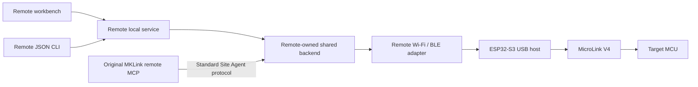

# Shared-session architecture

The workbench and `mklink-remote.exe` access one authenticated loopback service. The original MKLink remote MCP connects to a standard site registered by Remote and has its own client identity. Both reach the same target backend, job journal and acquisition buffers.

`desktop/mklink-wireless-config/adapter/` contains the maintained server patch and wireless transport. The staging script checks both the upstream commit and patched file hashes. Original MCP client modules are checked byte-for-byte against the pinned upstream source.

RTT/Trace subscribers have independent cursors and ownership. A subscriber leaving does not necessarily stop another client's producer. Reset, programming and explicit producer stop affect the shared target. A submitted flash job must be polled to a terminal outcome; submission success is not flash success.

S3 provides USB-UART maintenance, AP/STA/AP+STA, encrypted BLE and USB host transfer. Its PSRAM buffers absorb bursts; they do not increase USB Full Speed's wire rate. BLE delivery uses bounded windows while HTTP may negotiate larger windows.

The Remote HTTP client reuses a connection for consecutive RPCs and opens a fresh
connection after more than one second idle. A transport failure closes the socket
without replaying the POST. For legacy periodic dumps the parser separates the
generated command echo at stream start from discarded sample bytes. Reported
sample rates count complete region groups, including all blocks of a split group.

On nodes advertising `independent_read_sequence`, the Wi-Fi backend receives
MUX data over a separate HTTP connection with an 8 KiB bound. These reads have
their own monotonic sequence bound to the original stream open, controller and
USB generation. A timer services the existing MUX command slot during Watch
acquisition even while a sample response is in flight. The sole reader still
parses all V4 replies in wire order. BLE and older nodes use a 4 KiB MUX read
bound; non-MUX reads keep their negotiated window.
When both endpoints opt in to `zlib_pull_supported`, HTTP pulls of 512 B to
8 KiB can return an independent zlib block if it saves at least one eighth of
the payload. Incompressible or smaller pulls retain the original envelope.
The host checks the negotiated length and stream end before delivering bytes.
Heartbeat and STOP logs include cumulative native and pre-Base64 payload sizes.
A node advertising `stream_renews_lease` renews only after a successful
sequenced stream operation. Idle owners and older nodes use explicit renewals.
Connection diagnostics record heartbeat and STOP submission latency, RPC time
and, when available, the S3 monotonic times bracketing its USB transport call.
These timestamps confirm USB write completion, not receipt of a V4 MUX reply.

After a Watch target read error (status 5), SuperWatch normally decodes events
in small batches. At the no-sample deadline it checks the bounded queue of
events already received. A complete sample ends the error streak; failed
samples remain counted. If capture stops, the error includes the affected
address, number of error events, their device-time span and elapsed host time.

Secrets belong in the current user's protected configuration, not the repository. Changing a site endpoint may require reloading the original MCP because its site list is cached at startup. Neither source builds nor the CLI automatically change the computer's Wi-Fi.
