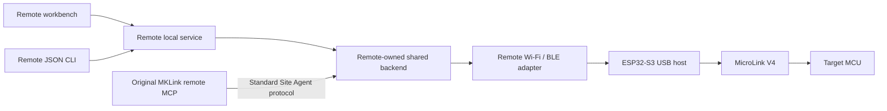

# Shared-session architecture

The workbench and `mklink-remote.exe` access one authenticated loopback service. The original MKLink remote MCP connects to a standard site registered by Remote and has its own client identity. Both reach the same target backend, job journal and acquisition buffers.

`desktop/mklink-wireless-config/adapter/` contains the maintained server patch and wireless transport. The staging script checks both the upstream commit and patched file hashes. Original MCP client modules are checked byte-for-byte against the pinned upstream source.

RTT/Trace subscribers have independent cursors and ownership. A subscriber leaving does not necessarily stop another client's producer. Reset, programming and explicit producer stop affect the shared target. A submitted flash job must be polled to a terminal outcome; submission success is not flash success.

S3 provides USB-UART maintenance, AP/STA/AP+STA, encrypted BLE and USB host transfer. Its PSRAM buffers absorb bursts; they do not increase USB Full Speed's wire rate. BLE delivery uses bounded windows while HTTP may negotiate larger windows.

Secrets belong in the current user's protected configuration, not the repository. Changing a site endpoint may require reloading the original MCP because its site list is cached at startup. Neither source builds nor the CLI automatically change the computer's Wi-Fi.
