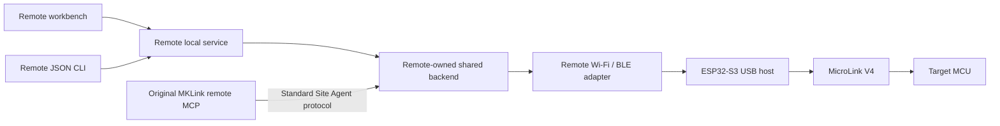

# Shared-session architecture

The workbench and `mklink-remote.exe` access one authenticated loopback service. The original MKLink remote MCP connects to a standard site registered by Remote and has its own client identity. Both reach the same target backend, job journal and acquisition buffers.

`desktop/mklink-wireless-config/adapter/` contains the maintained server patch and wireless transport. The staging script checks both the upstream commit and patched file hashes. Original MCP client modules are checked byte-for-byte against the pinned upstream source. The frozen-server build also rejects a stage whose commit or patch-file manifest differs from the current repository pin; the target-helper build checks the same commit. This binds builds to an explicit tested upstream revision instead of a moving latest version.

RTT/Trace subscribers have independent cursors and ownership. A subscriber leaving does not necessarily stop another client's producer. Reset, programming and explicit producer stop affect the shared target. A submitted flash job must be polled to a terminal outcome; submission success is not flash success.

S3 provides USB-UART maintenance, AP/STA/AP+STA, encrypted BLE and USB host transfer. Its PSRAM buffers absorb bursts; they do not increase USB Full Speed's wire rate. BLE delivery uses bounded windows while HTTP may negotiate larger windows.

The Remote HTTP client reuses a connection for consecutive RPCs and opens a fresh
connection after more than one second idle. A transport failure closes the socket
without replaying the POST. For legacy periodic dumps the parser separates the
generated command echo at stream start from discarded sample bytes. Reported
sample rates count complete region groups, including all blocks of a split group.

On nodes advertising `independent_read_sequence`, the Wi-Fi backend receives
MUX data over a separate HTTP connection with a negotiated bound up to 32 KiB. These reads have
their own monotonic sequence bound to the original stream open, controller and
USB generation. The PR #70 core keeps one target-command slot and a bounded,
separately correlated PING window on Remote HTTP and BLE links. A timer
can send these PINGs while a target response is in flight; each reply still checks
request ID, opcode, epoch, status and deadline. The sole reader still
parses all V4 replies in wire order. BLE RPCs remain strictly single-flight under
the fair transport lock; a pending native PING response does not occupy the target
command slot. BLE uses up to 16 KiB only when lossless read compression is
advertised; older nodes retain the 4 KiB MUX read bound.
When both endpoints opt in to `zlib_pull_supported`, HTTP pulls of 512 B to
32 KiB can return an independent zlib block if it saves at least one eighth of
the payload. Incompressible or smaller pulls retain the original envelope.
The host checks the negotiated length and stream end before delivering bytes.
BLE uses the same bounded decoder under `zlib_read_supported`, with uncompressed
fallback for payloads that do not save at least one eighth. The shared RPC lock
owns the input and codec until compression completes. A dedicated 32 KiB PSRAM
stack performs BLE compression; flash/NVS calls stay on the existing internal
BLE worker stack. Fixed notification pacing is retained. Removing it caused a
real receiver fragment mismatch and was rejected. TCP's send buffer is 32 KiB;
these lwIP buffers are allocated through the existing PSRAM configuration.

The S3 build uses software AES-GCM for BLE authentication/encryption. Hardware
AES can require internal DMA scratch space for unaligned PSRAM reply buffers;
large management responses failed under internal-heap pressure in qualification.
PSRAM capacity does not remove that internal-memory constraint. OTA reserves a
1 KiB internal readback buffer before beginning flash erase, then verifies the
complete APP in chunks. Allocation failure therefore leaves flash untouched;
SHA-256 and inactive-slot activation checks remain mandatory.

Remote sampling tracks elapsed delivery time against probe sample timestamps. If
a wireless stream remains over two seconds behind for two seconds, or exceeds
four seconds of lag, it reports explicit
backpressure and the owning capture performs normal STOP cleanup. It does not
silently change the requested rate. Cancellation during tail collection is
reported after cleanup so a disconnected client does not strand a pending STOP.
This protects session reuse; it does not claim the overloaded rate is supported.

Remote's private MUX request patch permits a STOP caller to consume bounded
queued sample snapshots while awaiting its reply, outside the reader condition
lock. Completion still requires the matching native STOP acknowledgement. A tail
decode error poisons the pending operation without replay. Captures preserve the
existing Watch protocol for small multichannel layouts: replacing it with bulk
reduced the measured 800 Hz request to about 500 Hz and was rejected.

The S3 HTTP task reserves one of three bounded request/response slots. Socket
workers receive complete request bodies and send replies on 4 KiB PSRAM stacks.
They never execute flash/NVS or probe operations: complete bodies are dispatched
through HTTPD's work queue onto its internal stack. Partial bodies have a total
2-second budget plus the current bounded receive; header/socket receive waits
are capped at 1 second. A parser timeout carries an explicit no-execution header;
the adapter permits one fresh-connection retry only for that 408 response.
Other failures never replay the POST. Failed IO shuts down the owned socket
before async completion. Slot state and errors remain visible in `http_send`.

A new connection may recover a known MUX session after the previous lease expires.
`probe.recover` requires the new lease, exact USB generation, an inactive update,
no storage upload, and the gateway's recorded MUX entry. It verifies probe-local
REPL identity, or performs fresh MUX HELLO/EXIT then verifies identity. It never
claims the target or repeats an old command. Only complete proof clears quarantine
and increments generation; the previous operation remains outcome-unknown.
Unknown legacy streams and USB hardware faults require separate maintenance.

Heartbeat and STOP logs include cumulative native and pre-Base64 payload sizes.
A node advertising `stream_renews_lease` renews only after a successful
sequenced stream operation. Idle owners and older nodes use explicit renewals.
Connection diagnostics record heartbeat and STOP submission latency, RPC time
and, when available, the S3 monotonic times bracketing its USB transport call.
USB timestamps confirm write completion, not receipt of a V4 MUX reply. A separate
CRC-checked diagnostic observer records PING and both STOP response identities,
without exposing payloads or changing the byte stream. Read diagnostics separate
USB dequeue time, compression time, native/encoded size and total RPC time.

After a Watch target read error (status 5), SuperWatch normally decodes events
in small batches. At the no-sample deadline it checks the bounded queue of
events already received. A complete sample ends the error streak; failed
samples remain counted. If capture stops, the error includes the affected
address, number of error events, their device-time span and elapsed host time.

Secrets belong in the current user's protected configuration, not the repository.
The PR #70 client can reload site registrations; older external MCP versions may
still need restarting. Remote registers 60-second call and 1200-second flash
deadlines and never upgrades the installed client implicitly. Neither source
builds nor the CLI automatically change the computer's Wi-Fi.

The private backend uses upstream transport policies and its single factory,
redirecting only S3 construction/registration to Remote's adapter. Wireless nodes
advertise `local_usb=False`; algorithm fallback and automatic reconnect stay
disabled, and a live reader retains ownership. Remote's asynchronous S3 flash-job
response remains compatible with older external clients: poll `jobs.status` to a
terminal result. Client source modules remain byte-identical to the new pin.

The new SuperWatch core requires the probe's `0x618` capabilities and validates
the acknowledged period/timebase. Large captures using the bulk path require
`0x800`. These are checked capabilities, not assumed firmware-version matches.
Unsupported probes fail before START; the adapter neither fabricates capabilities
nor silently selects legacy sampling. Old V4.7.2 measurements are historical and
do not qualify this backend. No probe firmware update is performed by staging.

Native firmware staging accepts BIN and Intel HEX, bounded to 1 MiB per file.
Staging is serialized independently of native reads and lease renewal. A failed
begin/chunk/commit is never replayed. After a failure, the adapter queries the
same lease's upload state and aborts only its unfinished temporary upload;
an already committed file is retained. An existing or changed upload is not
claimed. If cleanup cannot be confirmed, the original error and recovery hint
are returned. No programming command follows an unconfirmed commit.
HEX requires the gateway's `hex_files_supported` capability; older gateways
reject it before upload. The adapter validates HEX records and preserves the
original bytes, addresses and sparse segments for native MKLink `load.hex`.
Staging retains SHA-256 verification and never retries unknown writes.

The desktop reports `stop_requested` independently of `running`: accepting a
stop request does not complete a target job or release its resources. Older job
payloads default this field to false. SuperWatch's target helper emits a stopping
phase before its normal tail drain and reports native STOP verification only
after the matching acknowledgement completes. The UI labels parser frame drops
explicitly; absent quality counters remain unknown.

CLI `help` describes the invoking executable, while `call capabilities` queries
the running shared local service. Compare their backend binding after upgrading
the desktop; do not stop an older service while it owns active jobs or clients.

The workbench retires its local attachment even when the detach acknowledgement
is lost. It reports `backend_detach_confirmed=false` and a warning rather than
claiming that the backend or its jobs stopped. IPC framing failures and deadlines
retire only the workbench sidecar; no request is replayed and the independent
runtime is never killed. Status and detach have a 45-second IPC deadline. Long
capture calls retain budgets above the backend's supported operation limits.
Saved-node discovery returns identity, transport and address without credentials;
explicit reattachment by node ID resolves the existing private registration on
the backend. Device quarantine and job ownership checks still apply.
For an advertised recoverable MUX quarantine, a new connection observes the old
15-second lease until it expires, with a bounded wait, before submitting one
acquire and the existing recovery handshake. A live or busy owner is not revoked;
legacy/unsupported quarantine still requires maintenance. Recovery never resolves
or replays the previous operation.
